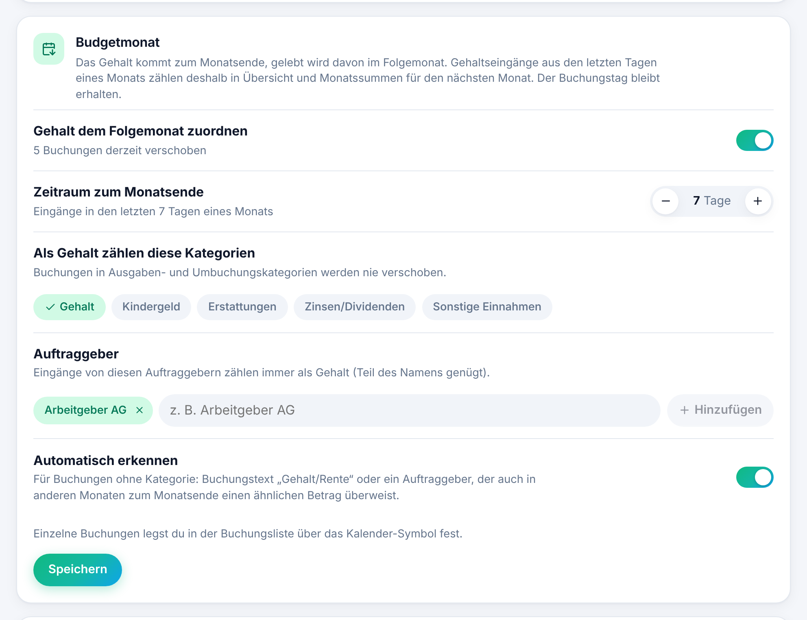

# Architecture

This document describes how Budgie is structured and why. For installation and usage, see the [README](../README.md).

## Design goals

- **Self-hosted and private.** Budgie runs as a small Docker Compose stack. Banking data, credentials and the categorization model never leave the host.
- **Modest hardware.** Everything, including the optional language model, runs on a CPU. No GPU is required.
- **Small households.** Built for a handful of users sharing one household, not for multi-tenant hosting.
- **Not exposed to the internet.** The app is meant to be reached on a local network or through a VPN, behind a reverse proxy that terminates TLS.

## Stack

| Area | Choice | Rationale |
| --- | --- | --- |
| Backend | Python, FastAPI | `python-fints` and the ML ecosystem are Python |
| Bank access | `python-fints` | Most mature FinTS library, supports decoupled TAN (app approval) |
| Database | PostgreSQL 16, SQLAlchemy 2, Alembic | Reliable, good for reporting queries |
| Frontend | SvelteKit 2 + Svelte 5, `adapter-node`, client-side rendering | Lightweight, fast, works well on phones |
| Classifier | scikit-learn | Trains in seconds on a CPU |
| LLM (optional) | Ollama, 7–8B quantized model (e.g. Qwen 2.5) | Fallback for uncertain cases, about 6–8 GB RAM |

## Services

| Service | Purpose | Network |
| --- | --- | --- |
| `web` | SvelteKit UI | reverse proxy |
| `api` | FastAPI: auth, FinTS dialog, import, categorization, REST API | reverse proxy + internal |
| `db` | PostgreSQL | internal only |
| `ollama` | Local LLM (optional, Compose profile `ai`) | internal + egress for model downloads |

Only `web` and `api` are reachable through the reverse proxy. All other services live on an internal Docker network without published ports.

Background work (FinTS syncs waiting for TAN approval, retraining, LLM categorization) runs in threads inside the `api` process. The API therefore runs as exactly **one** uvicorn worker; FinTS jobs and the PIN are kept in that process's memory only.

## Data flow

```
FinTS sync / CSV import
        │
        ▼
Normalization + duplicate detection
        │
        ▼
Categorization (rules → classifier → LLM)
        │
        ├── high confidence → assigned automatically
        └── low confidence  → suggestion, shown for review
                                   │
                                   ▼
                          user correction
                                   │
                                   ▼
                    new rule / background retraining
        │
        ▼
Overview: monthly totals per category, history, budget month
```

## FinTS and banking

- FinTS with PIN/TAN. With ING, the TAN step is "decoupled": the user approves access in the banking app and Budgie polls until the bank continues.
- Production use requires a free **FinTS product registration** with the Deutsche Kreditwirtschaft. Each installation uses its own product ID.
- Under PSD2, banks often only return the last 90 days without renewed strong customer authentication, and require it again periodically.
- Besides date, amount, payee and purpose, Budgie stores the **SEPA details** of the counterparty when the bank delivers them (IBAN, BIC, mandate reference, creditor ID, end-to-end reference). With MT940, the counterparty IBAN arrives glued to the front of the name (subfields `?31` + `?32`); Budgie splits it off. The duplicate fingerprint still uses the name as delivered, so earlier syncs remain recognized.
- **CSV import** from ING online banking is the second path, for older history and as a fallback.
- The **PIN is never stored.** It is entered for every sync and only held in memory for its duration. The login name and the python-fints client state (system ID, bank parameters, chosen TAN mechanism) are stored encrypted with a key derived from `BUDGIE_SECRET_KEY` (see `backend/app/crypto.py`).

### Duplicate detection

1. **Same fingerprint:** date, amount, payee and purpose match. Covers re-importing the same period from the same source.
2. **Different source, same day and amount:** CSV export and FinTS format payee and purpose differently. A transaction from the other source on the same day with the same amount counts as already present, counted per transaction.

## Learning categorization

1. **Rules:** fixed assignments, often created from corrections, e.g. "payee contains REWE → Lebensmittel › Supermarkt".
2. **Classifier:** TF-IDF character n-grams over payee, booking text and purpose, plus structural features (direction, amount size, booking type, part of month), with logistic regression. It is trained per household from manual assignments, rule matches and a small set of built-in seed examples, and retrains in the background after corrections.
3. **LLM fallback (optional):** for low-confidence cases, Ollama receives the category list and similar, already corrected transactions as examples. The answer is constrained to existing categories with a JSON schema.

The model only learns subcategories; the main category follows from them. Fine-tuning the LLM itself is out of scope.

Category sources are tracked per transaction (`manual`, `rule`, `model`, `llm`). Manual assignments are never overwritten, rules override AI assignments.

## Budget month

Salary usually arrives at the end of a month but pays for the following one. Budgie stores a separate `budget_date` per transaction. Incoming salary within the last days of a month (configurable, default 7) is moved to the first of the next month. Salary is recognized by category, by payer pattern, by the booking text "Gehalt/Rente", or by recurring end-of-month payments from the same payer. Users can override the month per transaction. See `backend/app/budget_month.py`.



## Users and accounts

- Every user has their own login.
- Accounts and categories belong to the shared household.
- Each account is either visible to all users or only to selected members.
- Every user manages their own bank logins.

## Default categories

Categories can be changed at any time in the UI. The default scheme is German, matching the UI:

| Main category | Subcategories |
| --- | --- |
| Wohnen | Miete/Kredit, Nebenkosten, Strom, Gas/Heizung, Internet/Telefon, Rundfunkbeitrag, Instandhaltung |
| Lebensmittel | Supermarkt, Bäcker/Metzger, Getränke, Drogerie |
| Haushalt | Einrichtung, Geräte, Reinigung, Garten |
| Shopping | Kleidung, Elektronik, Online-Handel, Geschenke |
| Kfz und Mobilität | Tanken/Laden, Werkstatt/Wartung, Kfz-Versicherung, Kfz-Steuer, ÖPNV/Bahn, Parken/Maut |
| Versicherungen | Haftpflicht, Hausrat, Leben/BU, Rechtsschutz, Sonstige |
| Gesundheit | Apotheke, Arzt/Zuzahlung, Optiker, Sport/Fitness |
| Freizeit | Restaurant/Lieferdienst, Ausflüge/Events, Hobbys, Urlaub/Reisen |
| Abos und Medien | Streaming, Software/Apps, Zeitschriften, Mitgliedschaften |
| Kinder und Haustiere | Betreuung/Schule, Kinderbedarf, Tierbedarf/Tierarzt |
| Finanzen | Sparen/Depot, Kredittilgung, Bankgebühren, Steuern, Spenden |
| Einnahmen | Gehalt, Kindergeld, Erstattungen, Zinsen/Dividenden, Sonstige Einnahmen |
| Umbuchungen | Transfers zwischen eigenen Konten (transfers between own accounts; counted as neither income nor expense) |
| Sonstiges | Bargeld, Unkategorisiert |

## Roadmap

- [x] **MVP 1:** data model, login, CSV import, categories, rules, monthly overview
- [x] **MVP 2:** FinTS sync with TAN flow (manual, with PIN entry)
- [x] **Phase 3:** classifier, review list, automatic retraining, optional Ollama fallback, budget month
- [ ] **Phase 4:** budgets, reports
- [ ] Documented backup strategy for the database
- [ ] Scheduled sync (would require storing the PIN and is deliberately left open)
